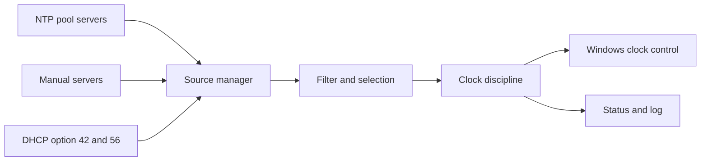

# ntptimeclient-winrs: design

Status: draft for approval. Date: 2026-11-10. Project name `ntptimeclient-winrs`, chosen by Terry.

## Intent

Wrong time breaks things quietly. It breaks message validity, TLS handshakes and log ordering. Busy machines drift. Default Windows time sync is weak on machines that are not domain joined.

This project is an open-source Windows service. It keeps the system clock as close to correct as it can, all the time.

Its job is to fix the clock. It is not to report that the clock is wrong.

## Why now

Research found a gap. All findings below come from web searches and fetched pages unless marked "unverified". Sources are listed in the chat history of the design session and are not linked here.

- Domain-joined Windows machines sync from their domain controller. This works well when the PDC emulator has a good source.
- Windows Home cannot join a domain (unverified, from training data). It uses `time.windows.com` and, per one third-party blog, syncs weekly.
- Microsoft says `w32time` is not a full NTP solution for time-sensitive applications. The source is Greyware quoting the technical reference. The original was not read.
- NetTime, the best-known open-source Windows client, is SNTP only. It has no authentication and no continuous clock discipline. Its last stable release is 3.14.
- The Meinberg NTP build is real NTP and open source. It is the closest alternative. Its Windows 11 support is not stated and its last release is about 14 months old.
- chrony has no Windows support and no plans for it.
- ntpd-rs is Rust, Apache-2.0 and MIT, and has NTS. It documents Linux packages only. Windows support is unknown.

## Goals

1. Keep the Windows system clock as close to correct as the sources allow, continuously.
2. Stay correct on busy machines. Poll adaptively, learn the drift rate and correct the clock frequency.
3. Prefer smooth correction (slew) over jumps (step). Step only for a large offset.
4. Take time from NTP pools, manual servers and DHCP-supplied servers.
5. Survive bad sources. Select by agreement, so one bad server cannot move the clock.
6. Run unattended as a Windows service with safe defaults.
7. Be open source, easy to audit and easy to build.

## Non-goals

- Not a replacement for Meinberg NTP or chrony on servers with specialist needs.
- No PTP in version one.
- No NTP server mode in version one. (Builder's call.)
- No NTS in version one. NTP pools do not offer it, as far as I know (unverified). Revisit for manual servers.
- No Windows 7, 8, or XP. No 32-bit target unless it is free.
- No GUI in version one. (Builder's call.)
- No alerting or monitoring product.

## Anti-goals

The project has failed, even if it technically works, if any of these is true.

- It competes with another time service and the clock ends up worse than the Windows default.
- It jumps the clock during normal operation.
- It hammers the NTP pools or ignores Kiss-of-Death replies.
- It lets one bad or hostile source set the time.
- Users have to click through antivirus warnings to install it. (NetTime asks this of its users.)

## Constraints

- Language: Rust only.
- Platform floor: Windows 10 and later, Windows Server 2016 and later. Standard Rust targets need Windows 10 (Rust blog, Feb 2024).
- Licence: MIT OR Apache-2.0, matching ntpd-rs. Confirmed in chat with "sounds fine". Re-confirm the file text at repo creation.
- Host: GitHub, personal account.
- Dependency: reuse ntpd-rs. Author's call after research: depend on the published `ntp-proto` crate for packet parsing and algorithms. 1.9.0 is the latest on crates.io today. Allow patch updates on the 1.9 line, commit `Cargo.lock`, and review every bump. Stay on 1.x until 2.0 is published and assessed. Do not fork the whole repo. Write the Windows daemon, socket, clock-control and DHCP layers ourselves. See the research notes for why.
- Releases must be code signed.
- Accuracy has no fixed target. Every use of time has its own tolerance. The service minimises error and does not promise one number.

## Decisions made by Terry

| Decision | Source |
|---|---|
| Open source, GitHub, personal account | chat |
| Windows only | chat |
| Rust only. No C++ or Pascal build. | chat |
| Floor is Windows 10 and Server 2016 | chat |
| Sources: NTP pools, manual servers, DHCP | chat |
| The tool corrects time. No alerts. | chat |
| Continuous discipline, because busy machines drift | chat |
| Reuse ntpd-rs code | chat ("sounds fine") |
| Licence MIT OR Apache-2.0 | chat ("sounds fine") |
| Project name `ntptimeclient-winrs` | chat |
| Domain join: detect, log, warn. The user decides. | chat |
| Source precedence: config file, then DHCP (detect, log, show differences), then global pool | chat |

## Design

### Shape

- **Source manager.** Resolves names, tracks each source, polls adaptively, respects Kiss-of-Death.
- **Filter and selection.** Per-source sample filtering, then agreement across sources. Rejects outliers. Weights by delay and stability. This is the part to take from ntpd-rs.
- **Clock discipline.** Turns the chosen offset into a frequency adjustment and, for large offsets, a step. Learns the drift rate. Free-runs on it when no source is reachable.
- **Windows clock control.** Calls the Windows time APIs. The service needs the system-time privilege. See the risk list.
- **Status and log.** A local status command and a log file. Diagnostic only. No alerts.

### Sources

- Config file servers. First priority.
- DHCP-supplied servers. Second priority. Listed below.
- The global NTP pool (`pool.ntp.org`). Last fallback. Terry chose the global pool. A regional zone is not used unless Terry changes this.
- DHCP-supplied servers: option 42 (IPv4) and option 56 (DHCPv6). Option numbers are from training data and unverified.
- Precedence is strict: config file, then DHCP, then the global pool. The first tier that has usable sources wins. Lower tiers are not mixed in. Terry's rule.
- DHCP sources are detected and logged. If they differ from the config file, the difference is shown to the user. Terry's rule. Where it is shown is the builder's call.
- Filtering and agreement voting run inside the chosen tier.
- What makes a tier unusable, and how fast the service falls to the next tier, is the builder's call. It must not flap between tiers.

### Pool behaviour

- Respect Kiss-of-Death and back off.
- Stay inside the pool project's polling guidance.
- A product that uses `pool.ntp.org` by default may need its own vendor zone. This is from training data and unverified. Confirm with the pool project before the first public release.

### Clock control

- Slew for small offsets. Step only above a threshold. The threshold is the builder's call.
- Windows has no `adjtimex`. The likely API is `SetSystemTimeAdjustmentPrecise` for slewing and `SetSystemTime` for stepping. Unverified. The builder must confirm.
- The service must stop `w32time` or otherwise take over, so two services do not fight. Meinberg NTP is reported to disable `w32time` by default. The exact method here is the builder's call.
- Secure Time Seeding can move the clock. Microsoft recommends disabling it on Server 2016 to 2025 (search result). It is a `w32time` feature, so with `w32time` stopped it should not act. That is unverified. The service must tolerate clock changes it did not make.
- On virtual machines the hypervisor may also set the clock. Detecting this is out of scope for version one. Note it in the install guide and measure on a VM with hypervisor time sync turned off.

### Polling and drift

- Poll more often when the clock is unstable and less often when it is stable.
- Learn the drift rate and apply a frequency correction.
- Keep timestamps as close to packet arrival as Windows allows. Run the timing path at a priority that survives CPU load.

### Configuration

- A config file. Format is the builder's call.
- Safe defaults: pool zone, no manual servers, DHCP on.
- Per-machine overrides for polling limits and the step threshold.

### Security

- The service parses network input and runs with a time-setting privilege. Parsers must be small, separate and fuzzed.
- Release binaries are code signed. The installer is signed.
- Least privilege. Drop every privilege the service does not need.
- DHCP is unauthenticated. A rogue server can add bad sources. Agreement voting is the defence. It fails if bad sources outnumber good ones.

## Measuring success

There is no fixed accuracy number. Success is measured, not promised.

- Compare clock offset over time against a reference, with the service and with the Windows default, on the same machine.
- Repeat under CPU load, during sleep and resume, and on a virtual machine.
- Success means the service beats the Windows default in each case, and never makes the clock worse.

## Testing

- Unit tests on filter and selection logic using recorded samples.
- Fake NTP servers that inject faults: wrong time, Kiss-of-Death, delay spikes, truncated packets.
- Fuzzing of the NTP packet parser, DHCP option parser and config parser.
- Soak tests for drift under load.
- CI runs on Windows 11 and one Windows Server release. Other releases, including Server 2016, are checked by hand before a release.

## Decisions left to the builder

- Crate layout. The spike on `ntp-proto` decides how much of its API we can drive without the ntpd-rs daemon. If it cannot be driven that way, the fallback is to vendor the needed modules under their licence, or write the NTP core.
- Config file format.
- Slew versus step threshold.
- How to take over from `w32time`.
- How to read DHCP-supplied servers on Windows.
- Installer format.
- Service account and privilege set.
- Default polling limits.
- Log format and status command design.

## Open questions for Terry

- Who owns the code signing certificate?
- Should version two add NTS for manual servers?

## Calls made by the author (not yet checked by Terry)

- **Taking over from `w32time`.** Stop and disable it on install. Record the old state and restore it on uninstall. If `w32time` is running and cannot be stopped, for example Group Policy restarts it, the service does not adjust the clock. It logs the reason and keeps measuring. Two services adjusting one clock is worse than none adjusting it.
- **Pool default and vendor zone.** The last-resort source is the global pool. The vendor zone request goes to the pool project before the first public release. Until then, only developer previews ship.
- **Sleep and resume.** A large offset after resume is exceptional, not normal operation. A step is allowed once, if the offset is above the step threshold. Small offsets still slew. The drift rate is saved to disk so it survives restart and resume.
- **Supported systems.** Windows 10, Windows 11, and Server 2019, 2022 and 2025 are supported. CI runs Windows 11 and one Server. Server 2016 is best effort, since its extended support ends in January 2027.
- **Domain join handling.** Terry's rule is detect, log, warn, and leave the choice to the user. Detection covers classic domain join only. Azure AD and hybrid join are out of scope for version one. Interactive install warns and asks. Every start logs the join state. A silent install on a domain-joined machine aborts unless `--confirm-domain-joined` is given. The abort is the author's call. It replaces the earlier idea of installing a service that does nothing.
- **Step limits.** Step only above 128 ms. Refuse a step above 1000 s unless config allows it. During normal operation a large offset is slewed at a capped rate. One step is allowed after start and one after each resume. Thresholds are the author's calls from ntpd convention in training data and are unverified.
- **Single-source tiers.** Decided by Terry on 2026-11-10: while a config or DHCP tier is active, the service queries the pool in observe-only mode. If the pool disagrees by more than the step threshold, the service refuses to step and only slews within the cap. The pool never feeds selection, so tiers stay unmixed.
- **Pool names.** A pool name resolves to several servers. A resolver expands it, caps the count, and drops loopback, link-local, multicast and the machine's own addresses.
- **Clock rate after a crash.** Windows may keep a non-nominal clock rate after the service dies. The service reads the rate at start and resets it. It resets the rate on stop.
- **State directory.** Writable by SYSTEM and Administrators only. A saved drift outside plus or minus 500 ppm is ignored.
- **Privilege.** One process in version one, running with only the system-time privilege. Parsers are fuzzed. A privileged broker split is a later option.
- **DHCP.** IPv4 option 42 only in version one. DHCPv6 is deferred. If Windows offers no supported way to read option 42, version one ships without DHCP.
- **Unsigned previews.** Developer previews may be unsigned and are labelled as such. Public releases are signed.

## Risks

- Strict tiers weaken voting. A config file or DHCP tier may hold only one or two servers. One server has no majority to check it. A bad config or DHCP server then sets the clock with no cross-check from the pool. This is a consequence of Terry's precedence rule. It is raised here for Terry to accept or change.

- ntpd-rs does not build on Windows today (open issue #2258). The daemon's clock and socket code is Unix only. We reuse only `ntp-proto`. Whether its algorithms can run without the daemon is not confirmed. A short spike answers it. Fallback is to vendor modules or write the NTP core. Estimated effort is 2 to 4 months for the core and discipline (author's estimate, not measured).
- ntpd-rs 2.0 is a large internal rework, in alpha. `ntp-proto` has no stated API stability policy. Pin the version and expect migration work.
- `ntp-proto` pulls in `tokio` and `rustls` as hard dependencies. The `aws-lc` default feature may need CMake and a C toolchain on Windows. This is general knowledge and unverified. The `rustcrypto` feature may avoid it.
- The ntpd-rs project dismisses contributions that show heavy generative AI use. Upstream patches from this project may be refused. This is another reason not to plan around upstreaming.
- The ntpd-rs advisory list has 7 entries, 2 rated High, all in or near NTS code. Our version one has no NTS, so less of that surface applies.
- Windows gives a coarse clock adjustment API and a noisy clock. Tight accuracy may be hard to reach. That is why success is measured against the Windows default.
- Taking over from `w32time` can break domain behaviour on joined machines. Domain-joined machines already do well, so the default should leave them alone. This is a guess. The builder must decide.
- Pool etiquette and vendor zone rules may limit how fast the service can chase drift.
- A new service that sets the system clock and runs privileged is a trust risk. Signing and fuzzing are the controls.

## Research notes

Verified by web search or page fetch in this session:

- Rust standard Windows targets need Windows 10. Windows 7 survives only as Tier 3 targets.
- NetTime is BSD licensed, SNTP only, with 3.14 as the stable release. Its homepage asks users to click through Defender warnings because the installers were recently signed with a new certificate.
- Meinberg NTP current build `ntp-4.2.8p18a2`, released 2025-09-17, signed, OpenSSL 3.0.17.
- chrony FAQ says no Windows support and no plans.
- ntpd-rs v1.9.0, 12 June 2026, Apache-2.0 and MIT, NTS supported.
- Windows Server 2016 and later can reach about 1 ms under good conditions per Microsoft.
- Server lifecycle dates: Server 2016 to January 2027, 2019 to January 2029, 2022 to 2031-10-14, 2025 to 2034-11-14.

ntpd-rs, verified from GitHub, crates.io and the project docs on 2026-11-10:

- Repo `pendulum-project/ntpd-rs`. Licence `Apache-2.0 OR MIT`. Active. Last commit 2026-11-09. Stable v1.9.0 (2026-06-12). 2.0 alpha (2026-07-15).
- Maintained by Tweede golf, under the Trifecta Tech Foundation. 14 human contributors in the top 15.
- Windows: open issue #2258 says it does not compile. Labelled `open-to-pr` and `looking-for-sponsor`. Maintainers say they likely will not do it soon. Releases are Linux packages only.
- `ntpd/src/daemon/clock.rs` uses `clock_steering::unix::UnixClock`. `sockets.rs` uses Unix domain sockets. No Windows clock code was found. The code-search check for `cfg(windows)` failed with HTTP 401, so that check is incomplete. Windows CI was not read.
- `ntp-proto` 1.9.0 is a published library. Apache-2.0 OR MIT. Described as packet parsing and algorithms. Hard dependencies include `tokio`, `rustls`, `rand`, `serde`.
- `clock-steering` 0.2.1 (2024) and `timestamped-socket` 0.3.0 (2026) are Apache-2.0 OR MIT. The standalone `timestamped-socket` repo was archived on 2026-11-06. Both crates are workspace members of ntpd-rs, so they likely moved into the main repo. That inference is mine.
- Security: one independent audit (Radically Open Security, 2023-04, report not opened). 7 advisories from 2023 to 2026. Two rated High, both in NTS server code.
- The ntpd-rs CONTRIBUTING file says contributions "clearly showing heavy use of generative AI" will be dismissed out of hand.
- Other Rust NTP crates: `sntpc` 0.11.0 and `rsntp` 4.1.2 are SNTP only. No other full NTP implementation was found in the top results.
- MSRV: workspace `rust-version` 1.95, edition 2024. `ntp-proto` 1.9.0 `rust_version` 1.88.

Unverified, from training data:

- Windows Home cannot join a domain.
- DHCP option numbers 42 and 56.
- Windows API names for clock control.
- NTP pools offer no NTS.
- Vendor zone rule for shipped products.
